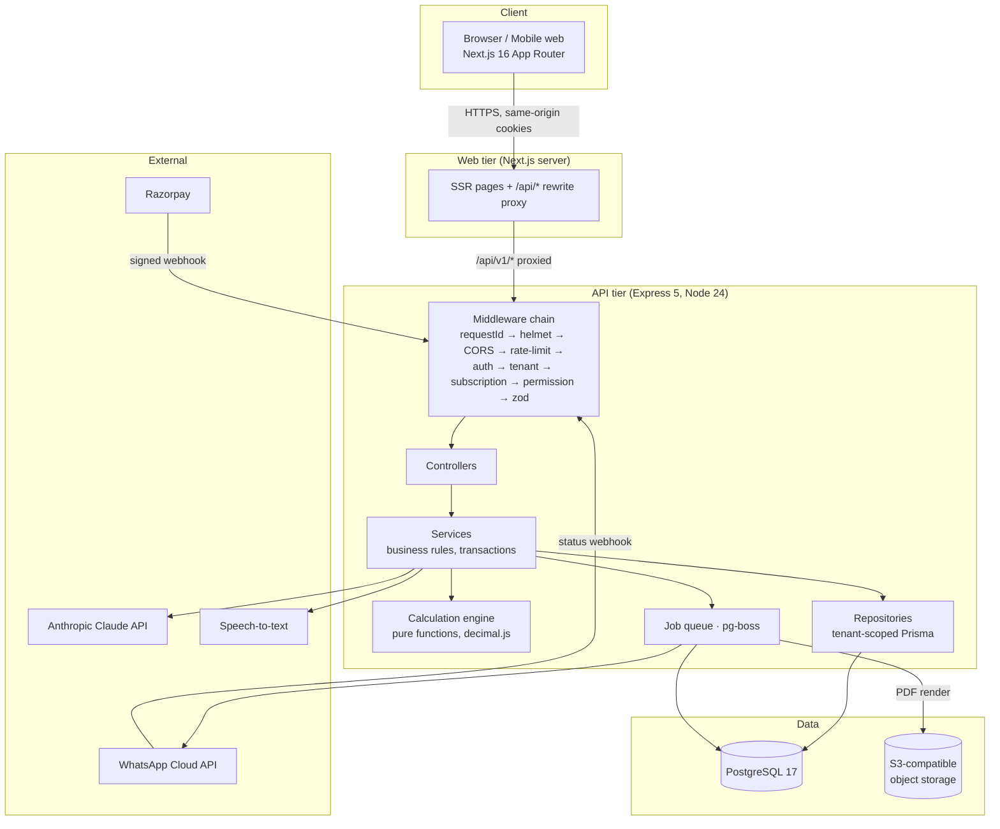
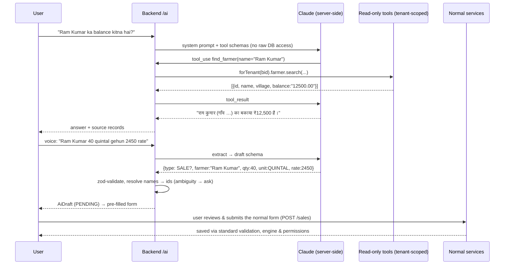

# MandiMitra AI — Architecture

## 1. System overview



**Why this shape**

| Decision | Choice | Reason |
|---|---|---|
| Separate API service | Express, not Next.js route handlers | The brief asks for separate frontend and backend. It also keeps all financial logic, background jobs and webhooks in one long-running process that's easy to test |
| Same-origin API via Next rewrite | `app.example.com/api/v1/*` → API | HttpOnly cookies work without third-party cookie issues. CORS stays simple and `SameSite=Lax` covers most CSRF |
| Job queue | **pg-boss** (Postgres-backed) | No Redis to run. Jobs can be enqueued in the same DB transaction as the business write, so work is never lost or duplicated |
| PDF rendering | **Headless Chromium (Playwright)** rendering HTML templates | Devanagari needs real text shaping (conjuncts like क्ष and त्र, matras). PDFKit-style libraries break Hindi text. The patti HTML is also reused for print preview |
| Excel | `exceljs` | Streaming writer for large reports |
| Logging | `pino` with redaction paths | Structured JSON. Passwords, tokens, bank numbers and Authorization headers are redacted |
| Validation | **Zod 4** schemas in a shared package used by the backend and React Hook Form | One source of truth. The frontend validates for UX and the backend validates for security |

## 2. Monorepo layout

```
mandimitra-ai/
├─ package.json              npm workspaces root
├─ docker-compose.yml        local Postgres
├─ .env.example
├─ database/                 @mandimitra/database
│  ├─ prisma.config.ts       Prisma 7 config (datasource URL, migrations path, seed)
│  ├─ prisma/
│  │  ├─ schema.prisma
│  │  ├─ migrations/
│  │  └─ seed.ts             (Phase 2) permissions, roles, plans; dev demo data
│  ├─ generated/prisma/      generated client (git-ignored)
│  └─ src/index.ts           (Phase 2) exports PrismaClient factory + types
├─ packages/
│  └─ shared/                (Phase 2) @mandimitra/shared – Zod schemas, enums, permission keys, money formatters
├─ backend/                  @mandimitra/backend (Phase 2)
│  └─ src/
│     ├─ config/             env parsing (zod), logger, constants
│     ├─ middleware/         auth, tenant, permission, subscription, idempotency, error, rateLimit
│     ├─ routes/v1/          one router per resource
│     ├─ controllers/        HTTP ↔ service mapping only
│     ├─ services/           business logic, transactions, audit
│     │  └─ calculation/     commission & settlement engine (pure)
│     ├─ repositories/       tenant-scoped data access
│     ├─ validators/         re-exports from shared + API-only schemas
│     ├─ integrations/       ai/, whatsapp/ (cloud + mock), payments/, storage/, pdf/
│     ├─ jobs/               pg-boss workers
│     ├─ utils/
│     └─ tests/              unit/, integration/ (real Postgres), fixtures/
├─ frontend/                 @mandimitra/frontend (Phase 2/3)
│  ├─ app/                   (auth)/login, (app)/dashboard, farmers, … , admin/
│  ├─ components/            ui/ (primitives), layout/, data-table/, forms/
│  ├─ features/              farmers/, lots/, patti/ … (feature slices: hooks + components + api)
│  ├─ hooks/
│  ├─ services/              typed API client (fetch wrapper, refresh-on-401)
│  ├─ store/                 Redux Toolkit: session, activeBusiness, ui; RTK Query for server data
│  ├─ types/
│  ├─ validations/           re-exports from shared
│  └─ messages/              hi.json, en.json (next-intl)
└─ docs/
```

> The brief's `database/prisma/schema.prisma/` is a **file**, not a folder. Prisma 7 also supports a multi-file schema folder; we use a single file for now and can split by domain later.

## 3. Request lifecycle & middleware order

```
request
 → requestId (x-request-id)            correlation for logs & audit
 → helmet, cors(allowlist), compression
 → rateLimit (global; stricter on /auth)
 → cookieParser, json(limit 1mb)
 → authenticate      verify access JWT → req.auth = { userId, businessId, roleKey, isPlatformAdmin }
 → resolveTenant     load membership(businessId,userId); reject unless ACTIVE and business ACTIVE
                     → req.tenant = { businessId, permissions:Set }  (cached 60 s, busted on change)
 → requireSubscription  TRIALING/ACTIVE → full; PAST_DUE → read-only grace; EXPIRED/SUSPENDED → 402
 → requirePermission('lot:create')
 → validate(zodSchema)  body / query / params
 → idempotency       (POST on financial routes) replay stored response for a repeated key
 → controller → service
 → errorHandler      AppError → {success:false,error:{code,message,details}}; unknown → 500, logged
```

## 4. Multi-tenancy (defence in depth)

1. **Token binding.** The access JWT carries the active `businessId`. Switching business requires `POST /auth/switch-business`, which checks membership and issues a new token. The client never chooses a tenant per request.
2. **Membership re-check.** `resolveTenant` confirms the membership and business are still ACTIVE, so deactivating a staff member takes effect within the cache TTL rather than at token expiry.
3. **Tenant-scoped repositories.** Services never touch the global Prisma client. They receive `db = forTenant(businessId)`, a Prisma Client extension that injects `businessId` into every `where`/`data` on tenant models and throws if a query tries to override it. A lint rule forbids importing the raw client outside `repositories/`.
4. **Composite foreign keys.** Required references (Lot→Farmer, Sale→Buyer, Sale→Lot, Patti→Farmer, ledger→party, …) are `(businessId, xId) → (businessId, id)`. **Postgres itself rejects a row that links tenant A's sale to tenant B's lot.**
5. **Optional references** (e.g. `Purchase.pattiId`) can't be composite in Prisma. Services check them explicitly, and the integration suite covers them.
6. **Tests.** Every resource has a cross-tenant test: create data in tenant A, call as tenant B, expect 404 (not 403, so existence isn't leaked).
7. **Row-Level Security: considered, not enabled (Phase 7 decision).** RLS would need `SET LOCAL app.business_id` inside a transaction around *every* query. With Prisma's pooled driver adapter, that means wrapping each request in an interactive transaction: one held connection per request, and a global behaviour change across ~300 tested endpoints. The four layers above, plus the cross-tenant test per resource, already give database-enforced isolation where it matters most: composite FKs make cross-tenant links impossible to write. Revisit RLS if raw SQL outside `forTenant()` ever grows beyond reports and the drift check.

## 5. Authentication & session

| Item | Design |
|---|---|
| Password hashing | argon2id (memory 19 MiB, t=2, p=1, OWASP baseline) |
| Access token | JWT HS256, 15 min, claims `{sub, bid, role, pa}`, sent as an HttpOnly `mm_at` cookie (Path=/api) |
| Refresh token | 256-bit random opaque token, 30 days, HttpOnly `mm_rt` cookie (Path=/api/v1/auth). Only its SHA-256 hash is stored |
| Rotation | Every refresh issues a new token in the same `familyId`. Presenting an already-rotated token revokes the whole family and logs `TOKEN_REUSE_DETECTED` |
| CSRF | SameSite=Lax cookies + same-origin proxy + a required `X-Requested-With: mandimitra` header on state-changing requests (simple cross-site forms can't set custom headers). CORS allowlist |
| Lockout | 5 failed logins → 15 min lock per account, plus an IP rate limit on `/auth/*` |
| Super Admin | `User.isPlatformAdmin`. Routes under `/api/v1/admin/*` have their own guard and are never tenant-scoped |

## 6. Authorization (RBAC)

Permissions are `resource:action` keys seeded into `Permission`. System roles map to them as follows:

| Permission group | OWNER | MUNIM | VIEWER |
|---|:-:|:-:|:-:|
| farmer / buyer / commodity: read | ✓ | ✓ | ✓ |
| farmer / buyer: create, update | ✓ | ✓ | — |
| farmer / buyer: delete (soft) | ✓ | — | — |
| commodity, commission rules, settings: manage | ✓ | — | — |
| lot / sale / purchase: create | ✓ | ✓ | — |
| lot / sale / purchase / payment / patti: cancel | ✓ | request → approval | — |
| patti: create, finalize | ✓ | ✓ | — |
| payment / expense: create | ✓ | ✓ | — |
| ledger / reports: read | ✓ | ✓ | ✓ (assigned scope) |
| reports: export | ✓ | ✓ | — |
| ledger: manual adjustment | ✓ | request → approval | — |
| staff, subscription: manage | ✓ | — | — |
| ai: query | ✓ | ✓ | ✓ (read tools only) |
| ai: draft | ✓ | ✓ | — |
| whatsapp: send | ✓ | ✓ | — |
| approvals: decide | ✓ | — | — |

Checks happen in `requirePermission`. The frontend reads `/auth/me` permissions only to hide controls.

## 7. Financial core

### 7.1 Money rules
- DB: `NUMERIC(14,2)` for money, `NUMERIC(14,3)` for weight in kg, `NUMERIC(12,2)` for rates, `NUMERIC(12,4)` for rule values.
- Code: `decimal.js` (Prisma `Decimal` is decimal.js-compatible). **No `number` arithmetic on money anywhere.** An ESLint rule flags `+ - * /` on fields typed `Decimal`.
- API: amounts serialise as **strings** (`"125000.00"`). The frontend only formats them (Intl `en-IN` → ₹1,25,000.00) and never sums them for persisted values.
- Rounding: each line amount is `ROUND_HALF_UP` to 2 dp **before** summing. Optional net round-off to the nearest rupee is shown as its own line.

### 7.2 Calculation engine (pure, deterministic)

```ts
// services/calculation/
toKg(qty, unit, bagWeightKg?)            → Decimal
amountFor(weightKg, rate, rateUnit, bagWeightKg?) → Decimal (2dp)
resolveRules(rules, {commodityId, date, side}) → CommissionRule[]   // commodity-specific beats generic per chargeType
applyRule(rule, {grossAmount, weightKg, bags, txnCount}) → ChargeLine
computePatti({purchases, rules, manualDeductions, outstandingAdvance, settings}) → PattiComputation
computeSale({weightKg, rate, rateUnit, rules}) → SaleComputation
```
No I/O and no clock access (the date is passed in). It is exhaustively unit tested, including edge cases: zero weight, negative inputs, deductions greater than gross (rejected), per-bag rules with bags = 0, and rule effective-date boundaries.

### 7.3 Transaction patterns

**Record sale (COMMISSION_AGENT mode)** — one `prisma.$transaction` at READ COMMITTED:
```
1. SELECT lot FOR UPDATE                          -- serialises concurrent sales on the same lot
2. assert lot.status ∈ {CONFIRMED, PARTIALLY_SOLD}
3. assert lot.soldWeightKg + w ≤ lot.netWeightKg  -- DB CHECK backs this up
4. compute = engine.computeSale(...)
5. nextNumber(SALE), nextNumber(PURCHASE)         -- DocumentSequence row lock
6. INSERT Sale + SaleCharges; INSERT Purchase (rate = sale rate, saleId)
7. UPDATE lot sold/purchased weight + status
8. SELECT buyer FOR UPDATE → INSERT BuyerLedgerEntry(debit, balanceAfter) → UPDATE buyer.currentBalance
9. INSERT AuditLog
```

**Finalize patti (as built):**
1. Lock the farmer and recompute from fresh data with the engine.
2. Insert the patti as FINALIZED, with a Deduction snapshot and frozen farmer and business snapshots.
3. Claim the purchases with a conditional `updateMany … WHERE pattiId IS NULL`. If the count doesn't match, a concurrent patti won the race, so roll back with `409`.
4. Credit the farmer ledger with **`netAmount + roundOff`**, then audit.

Crediting net + round-off, not just `netAmount`, keeps the ledger balance equal to the printed "net payable" once the advance is netted. Otherwise ±₹0.50 residues would build up per patti.

**PDF generation:** done on demand (not queued) with `playwright-core` driving an existing Chromium-family browser (`PDF_BROWSER_PATH`, or the installed Edge/Chrome/Chromium it finds). It is offline: every network request is blocked and JavaScript is disabled in the PDF context. The HTML template is the same one used for printing. pg-boss queuing arrives with WhatsApp delivery in Phase 6.

**Record payment:** Idempotency-Key required → `INSERT … ON CONFLICT (businessId, idempotencyKey)`. If the row already exists, return the original payment (HTTP 200, `replayed: true`). Then lock the party → ledger entry → balance. Concurrent double-clicks are made safe by the unique constraint, not by timing.

**Cancel anything financial:** never `DELETE`. Status → CANCELLED, a REVERSAL ledger entry (`reversalOfId` is UNIQUE, so nothing can be reversed twice), lot stock restored, audit logged. A finalized patti can only be cancelled if no settlement payment has been allocated beyond the remaining balance. Otherwise the owner must post an adjustment.

### 7.4 Balances
`Farmer.currentBalance` / `Buyer.currentBalance` are caches that are only written inside the same transaction that inserts the ledger entry, while holding the party row lock. `balanceAfter` on each entry gives an O(1) running balance for statements. A nightly job recomputes Σ(ledger) and alerts on any drift (there should never be any).

## 8. AI Assistant architecture (Phase 6)



**As built (Phase 6):**
- **Model call:** [`backend/src/services/ai/`](../backend/src/services/ai/) runs a manual tool loop on `client.beta.messages.create`. It uses model `claude-opus-5-5`, adaptive thinking (always on for that model), `output_config.effort` from env, `fallbacks: "default"`, and top-level `cache_control`. There is no forced `tool_choice` (a 400 on Opus 5.5): the tools are `strict: true` and the system prompt steers.
- **Tools** ([`tools.ts`](../backend/src/services/ai/tools.ts)): `search_farmers`, `search_buyers`, `party_account`, `business_summary`, `sales_by_commodity`, `pending_buyer_payments`, `farmers_to_pay`, `calculate_amount`. All are read-only and tenant-scoped, and each is offered only if the caller holds its permission.
- **History is append-only:** the exact content blocks returned (including thinking and fallback blocks) are stored and replayed unchanged. Conversations are capped at 40 questions.
- **Drafts:**
  - Extraction uses structured outputs (`output_config.format: json_schema`).
  - Names are resolved to ids by **deterministic DB search**. Ambiguity is returned as candidates for the human to pick.
  - The draft opens the *normal* form, the normal endpoint saves, and then `POST /ai/drafts/:id/confirm` links the draft to the record.
- **Reminders:** the AI writes the text, but the amount is computed by the backend and must appear verbatim. Otherwise a fixed template is used.
- **Tests** run a scripted model ([`scripted-llm.ts`](../backend/src/tests/scripted-llm.ts)) and assert the outgoing requests: model, fallbacks, strict tools, no write tools, tenant isolation of tool results, append-only replay, the round cap, refusal handling and quota.

Safety guarantees:
- The LLM has **no write tools**. Drafts are stored as `AiDraft` rows, and only the regular endpoint (with its permission check and calculation engine) creates financial records.
- Tools run with `forTenant(req.tenant.businessId)` and the caller's permissions. A VIEWER's AI can't see anything the VIEWER can't.
- All arithmetic in answers goes through a `calculate` tool backed by the engine. The prompt tells the model to quote tool numbers verbatim.
- PII minimisation: only the fields a tool needs are sent. Bank details are never sent. Conversations are per user and stored with token counts for quota.
- Speech-to-text: browser Web Speech API (`hi-IN`) for v1 (free, on-device in Chrome). A server-side Indic STT provider is optional later. Decided in Phase 6.

## 9. WhatsApp (Phase 6, retries in Phase 7)
- `WhatsAppProvider` has three implementations, chosen by `WHATSAPP_PROVIDER`:
  - `cloud`: Meta Graph API.
  - `mock`: development only. It logs the message and marks it DELIVERED.
  - `disabled`: every send returns `503 WHATSAPP_NOT_CONFIGURED`.
- **Production refuses `mock`**, so the system never reports a delivery that didn't happen.
- Business-initiated messages use **pre-approved templates** only: `patti_ready_hi`, `statement_hi`, `payment_received_hi`, `payment_made_hi`, `payment_reminder_hi`. Variables come from backend data, never from AI output.
- Sending requires `whatsappConsent = OPTED_IN`. A STOP/बंद reply flips it to OPTED_OUT through the webhook.
- Webhook: signature checked with `X-Hub-Signature-256`, de-duplicated through `WebhookEvent`, and status only ever moves forward.
- **Retries:**
  - A temporary failure (network, Graph 5xx, rate-limit codes) leaves the message `QUEUED` and enqueues a `whatsapp-retry` job: backoff from 30 s, 5 attempts.
  - The worker rebuilds the send from the stored template variables and the stored PDF attachment.
  - A message is never sent twice: only `QUEUED` rows are retried.
  - A permanent error, or the last attempt failing, marks it `FAILED`.

## 10. Subscriptions & billing (Phase 7)
**Lifecycle**
- States: `TRIALING → ACTIVE → PAST_DUE → EXPIRED`, plus `CANCELLED` (stopped at period end) and business-level `SUSPENDED` (admin).
- Access is computed, not cached:
  - `effectiveSubscriptionStatus()` treats a passed trial or period date as EXPIRED / PAST_DUE immediately, even before the nightly job runs.
  - TRIALING and ACTIVE can write. Every other status is **read-only** — data is never held hostage.
  - `/billing/*` is exempt from the read-only gate, so an expired business can always pay.

**Prepaid periods (no mandates)**
- One Razorpay order per 30-day period. UPI works, and nothing is charged without the owner pressing Pay.
- Period arithmetic is a pure, unit-tested module (`services/billing/lifecycle.ts`):
  - trial payment → starts at trial end;
  - renewal → appended to the current period;
  - upgrade → starts now, credit = remaining × oldPrice ÷ newPrice;
  - downgrade → scheduled via `pendingPlanId` and applied by the nightly sweep at period end. Blocked if active staff exceed the smaller plan.

**Money path**
1. `POST /billing/checkout {planCode}` creates a `BillingPayment` (PENDING) and a Razorpay order for the plan's price. The client never sends an amount.
2. Checkout's `{order_id, payment_id, signature}` comes back to `POST /billing/verify` (HMAC with the key secret), and `payment.captured` arrives at `/webhooks/razorpay` (HMAC with the webhook secret; the amount must equal the order).
3. Both paths call `BillingService.activate()`. It locks the billing row and the subscription with `SELECT … FOR UPDATE` and applies the payment exactly once — the callback and the webhook usually arrive together.
4. The browser's word alone never activates anything. If the browser dies after paying, the webhook still activates the plan.

**Test mode:** `BILLING_PROVIDER=mock` is a local gateway with the same signature scheme. A dev-only endpoint plays the popup, so the real verify path runs. Production refuses `mock`.

**Nightly jobs** (pg-boss, IST cron, in the same PostgreSQL in the `pgboss` schema):
- `subscription-sweep` (00:10): expire trials, lapse periods, apply scheduled downgrades, expire after `BILLING_GRACE_DAYS`, and send in-app reminders 3 days and 1 day before the end (once each).
- `ledger-drift` (02:40): every cached balance must equal the sum of its ledger. It only reports, never "fixes".
- `JOBS_MODE`: `inline` (inside the API; dev / single server), `worker` (`dist/worker.js`, same image), or `off`.

**Super Admin**
- `/admin` re-checks `isPlatformAdmin` in the database on every request.
- It sees platform metadata only (businesses, owners, plans, SaaS payments, counts), never a firm's books.
- Suspend, reactivate and extend are audited, with a reason.
- There is no API to grant admin; use the `admin:grant` CLI.

## 11. Frontend architecture
- **Next.js 16 App Router** with route groups `(auth)`, `(app)`, `(admin)`. Server components for shells, client components for interactive tables and forms.
- **State:** RTK Query for server data (caching, invalidation tags per resource). Redux slices for session, active business and UI (sidebar, toasts).
- **Forms:** React Hook Form + `zodResolver(sharedSchema)`. Entry screens are keyboard-first (Enter moves to the next field, a hotkey saves).
- **i18n:** a typed in-house dictionary ([`frontend/lib/i18n.ts`](../frontend/lib/i18n.ts)) instead of `next-intl`. Hindi is the default with an English toggle. A compile-time check ensures both languages have every key. Chosen because the app is a client-rendered SPA behind login, so locale routing and SSR message loading would add complexity for no benefit. API error messages come localised from the server (`Accept-Language`).
- **Money display** ([`frontend/lib/format.ts`](../frontend/lib/format.ts)) groups decimal strings with pure string operations (₹12,34,567.50), so even ₹9,99,99,99,99,999.99 displays exactly. The frontend never sums money.
- **Charts:** dependency-free SVG. Measures with different scales (trade volume vs. commission/expenses) get separate charts, never a dual axis. Each chart has a legend, a hover/focus tooltip and a table view.
- **Not built:** dark mode.
- **Billing UI** (`/billing`): Razorpay Checkout.js is loaded only on that page. A banner explains read-only or trial-ending states and links to it.
- **Admin console** (`/admin`): its own shell, outside the business layout.
- **Design tokens (Tailwind 4 `@theme`):** primary deep green `#14532d`/`#166534`, accent warm orange `#ea580c`, background `#f7f6f3`, cards white, Inter + Noto Sans Devanagari. Large tabular numerals for amounts.
- **Calculated previews** in forms (e.g. sale gross while typing) call `POST /api/v1/calculate/*`, so the number on screen is the number that gets saved.
- Every list and form has skeleton loading, an empty state with a call to action, an error state with retry, confirmation dialogs for destructive actions, and toasts.

## 12. Observability & operations
- `pino` logs with `requestId`, `businessId` and `userId` (IDs only, no names or mobiles).
- Error monitoring: Sentry on the API and worker (`SENTRY_DSN`). Only unexpected errors are reported. User info, cookies, headers, bodies and query strings are never collected. The frontend has no Sentry SDK yet.
- Security headers: the web app sends a CSP (self + Razorpay only, `frame-ancestors none`), `X-Frame-Options`, `Permissions-Policy`, and HSTS when `APP_URL` is https. The API uses helmet.
- Production guards: the API refuses to start with mock WhatsApp, mock billing, a non-https `APP_URL`, a placeholder JWT secret, or incomplete Razorpay/S3 settings.
- Health: `/healthz` (liveness), `/readyz` (DB ping).
- Backups: managed Postgres PITR plus a daily logical dump to separate storage, with a restore drill each month.

## 13. Testing strategy
| Layer | Tool | Scope |
|---|---|---|
| Unit | Vitest | Calculation engine, unit conversion, numbering, permission matrix |
| Integration | Vitest + Supertest + real Postgres (test DB, truncated per file) | Every endpoint: auth, tenant isolation, concurrency (parallel sales on one lot, parallel identical payments), cancellations, ledger consistency |
| Invariants | Vitest (example-based; no property-testing library is used) | Engine: net = gross − Σdeductions across rule mixes. Ledger: Σentries = cached balance after the whole operations suite, plus the nightly drift check |
| E2E | Node scripts + Playwright (headless Edge) | Every page renders without console errors. Expired trial → banner → test checkout → plan active → receipt. Downgrade schedule/undo. Mobile width. Admin grant → search → extend |
