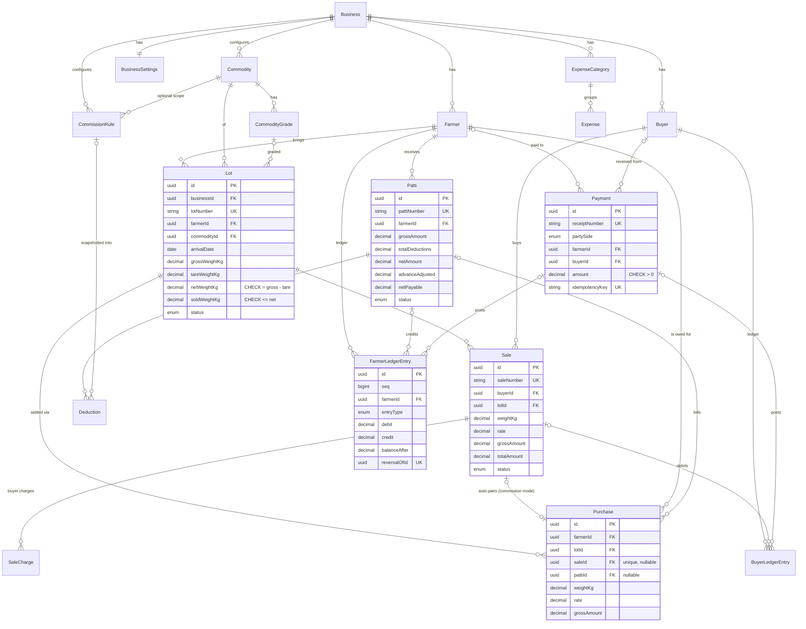
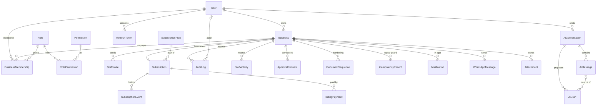

# MandiMitra AI — Database Design

Source of truth: [`database/prisma/schema.prisma`](../database/prisma/schema.prisma)

Migrations:
- [`20261119000000_init`](../database/prisma/migrations/20261119000000_init/migration.sql): schema plus hand-written CHECK constraints and partial indexes.
- `…_bank_details_viewed_activity`: adds the `BANK_DETAILS_VIEWED` activity type.

Prisma `migrate dev` was verified to produce no drift against the hand-written SQL.

PostgreSQL 17 · Prisma ORM 7.10.1 (`prisma-client` generator + `@prisma/adapter-pg`) · 42 models · 32 enums

---

## 1. ER diagram — mandi operations & money



## 2. ER diagram — identity, platform, AI



## 3. Model catalogue

| Domain | Models |
|---|---|
| Identity & tenancy | `User`, `RefreshToken`, `Business`, `BusinessSettings`, `Role`, `Permission`, `RolePermission`, `BusinessMembership`, `StaffInvite` |
| Masters | `Farmer`, `FarmerBankAccount`, `Buyer`, `Commodity`, `CommodityGrade` |
| Operations | `Lot`, `Purchase`, `Sale`, `SaleCharge` |
| Settlement | `CommissionRule`, `Patti`, `Deduction` |
| Money | `FarmerLedgerEntry`, `BuyerLedgerEntry`, `Payment`, `ExpenseCategory`, `Expense` |
| Plumbing | `DocumentSequence`, `IdempotencyRecord`, `ApprovalRequest`, `AuditLog`, `StaffActivity`, `WebhookEvent` |
| Billing | `SubscriptionPlan`, `Subscription`, `SubscriptionEvent`, `BillingPayment` |
| Comms & files | `Notification`, `WhatsAppMessage`, `Attachment` |
| AI | `AiConversation`, `AiMessage`, `AiDraft` |

The brief's `StaffActivity` covers login history and non-data events. `AuditLog` covers data changes. The brief's `Deduction` is the farmer-side patti line, and the buyer-side equivalent is `SaleCharge`.

## 4. Key design decisions

### D1 — UUIDv7 primary keys
`@default(uuid(7))` keys are time-ordered, so inserts append to the B-tree instead of scattering like v4 keys do. IDs are also safe to expose in URLs and can't be enumerated. Human-readable numbers (`L/2026-27/000123`) live in separate columns that are unique per tenant.

### D2 — Tenant isolation enforced by the database
Each tenant table has `@@unique([businessId, id])`, and each **required** reference to another tenant row uses a composite FK:
```prisma
farmer Farmer @relation(fields: [businessId, farmerId], references: [businessId, id])
```
A lot therefore can't point at another business's farmer, even if a service has a bug. Prisma can't make composite FKs **optional** when one column (`businessId`) is required, so nullable references (`Purchase.pattiId`, `Lot.gradeId`, `Payment.farmerId/buyerId`, ledger `paymentId`) use a plain FK and get an explicit tenant check in the service, plus integration tests. RLS is an optional Phase 7 hardening step.

### D3 — Canonical units
All weights are stored in **kg** as `NUMERIC(14,3)`. Conversion happens only in the calculation engine (`QUINTAL=100`, `TON=1000`, `BAG=commodity.bagWeightKg`). Rates keep their `rateUnit`, so a sale at ₹2,450/quintal is stored exactly as entered and can be audited.

### D4 — Decimal everywhere
Money is `NUMERIC(14,2)`, which holds up to ₹9,99,99,99,99,999.99. There are no floats anywhere. Rule values are `NUMERIC(12,4)` so that rates like 2.5 % or ₹0.0125/kg are exact.

### D5 — Append-only ledgers with cached balances
- Ledger rows are never updated or deleted. A correction is a `REVERSAL` entry whose `reversalOfId` is **UNIQUE**, so an entry can't be reversed twice.
- A `CHECK` makes each entry one-sided: exactly one of debit or credit is greater than 0.
- `seq BIGSERIAL` gives a stable order within a day. `balanceAfter` is written while holding a `FOR UPDATE` lock on the party row, so statements need no window functions and concurrent writes can't interleave.
- `Farmer.currentBalance` / `Buyer.currentBalance` are caches that are always updated in the same transaction, and a nightly job checks them for drift.
- Sign convention: **farmer** balance = Σcredit − Σdebit (positive means we owe the farmer, negative means they hold unadjusted advance). **Buyer** balance = Σdebit − Σcredit (positive is a receivable).

### D6 — Snapshots on finalized documents
`Deduction` and `SaleCharge` copy the rule's `calcMethod`, `rateValue`, `baseValue` and computed `amount`. `Patti.farmerSnapshot` and `businessSnapshot` freeze the names and addresses. Editing a commission rule or renaming a farmer later never changes a printed patti.

### D7 — Stock integrity
`Lot.soldWeightKg` and `purchasedWeightKg` are updated under a row lock, and the DB enforces `CHECK (soldWeightKg <= netWeightKg)`. Two munims selling the last 10 quintals at the same moment are serialised by the lock, and if anything slipped past, the CHECK would abort the second transaction.

### D8 — Gap-free document numbers
`DocumentSequence(businessId, docType, fiscalYear)` is locked and incremented inside the business transaction. A rolled-back transaction rolls back its number too, so there are no gaps. Postgres sequences can't do this. Gap-free numbering matters for auditors.

### D9 — Duplicate protection
- `Payment @@unique([businessId, idempotencyKey])`. The client generates a UUID when the form opens, so double-clicks, retries and two open tabs all resolve to one payment.
- `IdempotencyRecord` gives the same protection to other financial POSTs (sales, pattis, expenses) through the `Idempotency-Key` header. Reusing a key with a different body returns 422.
- The index `(businessId, mode, referenceNumber)` lets the API **warn** when a UPI/UTR reference is reused. It warns instead of blocking because cheque numbers can legitimately repeat across banks.

### D10 — Soft delete only for masters
`Farmer` and `Buyer` have `deletedAt`, because a farmer with history must stay referenced. Financial documents use `status = CANCELLED` and are never deleted. Ledger rows are immutable. Join and config rows (RolePermission, grades) are hard-deleted.

### D11 — FK delete behaviour
`Restrict` is the default for anything financial, so the DB refuses to orphan history. `Cascade` applies only to purely owned children (RolePermission, AI messages, notifications). `SetNull` is used for optional pointers to files and grades.

### D12 — Dates vs timestamps
Business dates (`arrivalDate`, `saleDate`, `paymentDate`, `entryDate`) are `DATE`, the mandi working day as the user enters it (IST), with no timezone shift. Audit times are `TIMESTAMPTZ(3)`.

### D13 — Sensitive data
`FarmerBankAccount.accountNumberEnc` holds AES-256-GCM ciphertext (key in `FIELD_ENCRYPTION_KEY`, rotatable via a key-id prefix), and only `accountNumberLast4` is stored in plain text. Passwords are argon2id. Refresh, invite and idempotency tokens are stored as SHA-256 hashes. Aadhaar is **deliberately not collected**.

## 5. Constraints added in raw SQL

Prisma can't express these, so they're appended to the init migration:

| Table | Constraint |
|---|---|
| Lot | gross > 0 · 0 ≤ tare < gross · **net = gross − tare** · 0 ≤ sold ≤ net · 0 ≤ purchased ≤ net · bags ≥ 0 · moisture 0–100 |
| Purchase / Sale | weight > 0 · rate > 0 · amounts ≥ 0 · `totalAmount = gross + charges` |
| Patti | **totalDeductions ≤ grossAmount** · net = gross − deductions · payable = net − advance + roundOff · advance ≤ net |
| CommissionRule | value ≥ 0 · percentage ≤ 100 · effectiveTo ≥ effectiveFrom |
| Ledger entries | exactly one of debit / credit > 0 |
| Payment | amount > 0 · exactly one party, matching `partySide` |
| Expense | amount > 0 |
| FarmerBankAccount | partial unique index: one primary account per farmer |
| Sale / Purchase | partial indexes on ACTIVE rows per lot |

## 6. Index strategy
- Every tenant list is filtered on `businessId` first, and composite indexes lead with it: `(businessId, arrivalDate)`, `(businessId, farmerId, status)` and so on.
- Searches: `(businessId, name)`, `(businessId, mobile)`, `(businessId, village)`. Phase 3 adds a `pg_trgm` GIN index on names for fuzzy Hindi/English search, which is especially useful for AI name resolution like "Ram Kumar" → "रामकुमार".
- Ledger statements: `(businessId, farmerId, seq)` gives an index-only ordered scan.

## 7. Seed data
- **All environments** ([`prisma/seed.ts`](../database/prisma/seed.ts), idempotent): 47 permissions, system roles (OWNER/MUNIM/VIEWER), the exact role↔permission matrix from [`packages/shared/src/permissions.ts`](../packages/shared/src/permissions.ts) (re-synced on each run), and the 3 subscription plans.
- **Per new business (at registration, same transaction):** settings, OWNER membership, the 7 default commodities with Hindi names, 7 default expense categories, and a 14-day PROFESSIONAL trial plus a `TRIAL_STARTED` event. `DocumentSequence` rows are created on first use (Phase 3+). **No commission rules are seeded.** The owner has to set them, so no mandi's rates are assumed.
- **Development only:** a demo business with realistic farmers, lots and transactions, behind a `SEED_DEMO=true` guard. It refuses to run when `NODE_ENV=production`.
