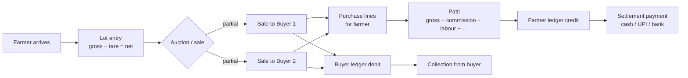

# MandiMitra AI — Product Requirements

> **आढ़ती का पूरा हिसाब, एक ही जगह।**
> A multi-tenant mandi management ERP for Indian commission agents (आढ़ती), grain traders and their munims.

Status: **Phase 1 – approved scope draft** · Last updated: 2026-11-19

---

## 1. Problem

An aadhati's day runs on handwritten bahi-khata registers. Farmers arrive with tractor-trolleys, lots get weighed and auctioned, sales are split across several buyers, pattis are written by hand, advances are given in cash, and reconciling all of it is slow. Mistakes in commission or labour deductions cause disputes. Outstanding buyer payments are tracked in memory. Generic accounting software (Tally, Busy, Vyapar) doesn't model *lots → partial sales → patti → farmer ledger*, and its English-first UI is hard for a typical munim to use.

## 2. Target users

| Persona | Description | Primary needs |
|---|---|---|
| **Aadhati / Owner** | Runs the firm, licensed at the APMC mandi. Often uses a smartphone more than a PC. | Daily overview, outstanding money, control over corrections |
| **Munim / Accountant** | Does the data entry at the gaddi, usually on a desktop or laptop, under time pressure during arrival season. | Fast keyboard entry, Hindi labels, correct automatic calculations |
| **Read-only staff** | Family member, auditor, junior clerk | View ledgers and reports without changing anything |
| **Super Admin** | MandiMitra platform operator | Onboard and support businesses, manage plans |
| **Farmer / Buyer** (external, no login) | Receives pattis, statements and reminders | Clear Hindi slip on WhatsApp |

## 3. Core domain flow

## 4. Key assumptions (documented, adjustable)

| # | Assumption | Why | Where it's configurable |
|---|---|---|---|
| A1 | Default trading mode is **COMMISSION_AGENT**: the farmer's purchase rate equals the auction/sale rate, and recording a sale auto-creates the matching farmer purchase line. **TRADER** and **MIXED** modes let purchases and sales have different rates. | This is how most aadhatis operate; traders also exist | `BusinessSettings.tradingMode` |
| A2 | Weights are stored in **kg** internally; rates are quoted **per quintal** by default. | Avoids unit conversion bugs; quintal is the mandi convention | `Commodity.rateUnit`, `defaultUnit`, `bagWeightKg` |
| A3 | Who pays commission differs by state (Punjab/Haryana: usually the buyer side; elsewhere: often the farmer). Each charge rule has `appliesTo = FARMER | BUYER`. | No hardcoded mandi rates | `CommissionRule` |
| A4 | The farmer ledger is credited when the **patti is finalized**, not on each sale, with net amount + round-off. Purchases not yet on a patti count as "unbilled payable". There are no draft pattis: preview, then finalize. Corrections are cancel + re-issue. | Matches the practice where the patti is the farmer's bill | — |
| A5 | Advances are debited to the farmer ledger when they're paid. On the patti, "advance adjustment" shows how much outstanding advance is netted off. It is **not** a second ledger debit. | Prevents double-counting | `autoAdjustAdvanceInPatti` |
| A6 | The patti net payable is rounded to the nearest rupee by default, and the round-off is shown on the patti. | Common practice for cash payments | `netRounding` |
| A7 | Financial year runs April–March. Document numbers reset each FY, e.g. `L/2026-27/000123`. | Indian FY | `fiscalYearStartMonth` |
| A8 | Login uses **mobile number + password** (email is optional). OTP login is a later enhancement. | Many users don't have or use email | — |
| A9 | GST on commission and mandi fee/cess filings are **out of scope for v1**. GSTIN is stored for display on documents. | Varies by state and needs CA validation | — |
| A10 | Plan limits (below) are initial values. They're stored in the DB and can change without a deploy. | Pricing will evolve | `SubscriptionPlan` |
| A11 | A user can belong to several businesses (e.g. one munim working for two firms) and switches between them. Each session is bound to one active business. | Real-world pattern | `BusinessMembership` |

## 5. Feature breakdown

Legend: **P** = phase delivered · ★ = MVP-critical

### 5.1 Platform & access
| Feature | Details | P |
|---|---|---|
| ★ Business registration | Owner signs up → business + settings + default commodities, expense categories, owner membership and a trial subscription are created in one transaction | 2 |
| ★ Auth | Mobile + password (argon2id), short-lived access JWT, rotating refresh token in an HttpOnly cookie, lockout after repeated failures | 2 |
| ★ RBAC | System roles OWNER / MUNIM / VIEWER with a permission matrix checked on the backend | 2 |
| ★ Tenant isolation | Middleware, a tenant-scoped data layer and composite FKs in the DB | 2 |
| Staff invite | Invite by mobile with a role → invite link → accept and set password | 2 / 5 |
| Login history & activity log | `StaffActivity` | 2 |
| Approval workflow | Munim cancel/edit of financial records → owner approves | 4 |
| Super Admin console | Businesses list, activate/suspend, plans, platform metrics | 7 |

### 5.2 Masters
| Feature | Details | P |
|---|---|---|
| ★ Farmers | CRUD, auto code `F-00001`, search by name/mobile/village, father's name, soft delete, optional encrypted bank details, WhatsApp consent | 3 |
| ★ Buyers | CRUD, auto code, GSTIN, opening balance (posted as a ledger entry), credit limit warning | 3 |
| ★ Commodities | Seeded: Wheat गेहूं, Paddy धान, Rice चावल, Mustard सरसों, Maize मक्का, Potato आलू, Onion प्याज. Units, bag weight, grades, active flag | 3 |

### 5.3 Operations
| Feature | Details | P |
|---|---|---|
| ★ Lot entry | Auto lot no., gross/tare/net (net computed by backend), bags, vehicle, grade, moisture. Status: DRAFT → CONFIRMED → PARTIALLY_SOLD → SOLD, or CANCELLED | 4 |
| ★ Sales | Buyer, lot, weight, rate → gross. Partial sales to several buyers. Sold weight can never exceed lot net (row lock + DB CHECK). Buyer-side charges | 4 |
| ★ Purchases | Farmer side of the lot. Auto-created in COMMISSION_AGENT mode, manual in TRADER mode | 4 |
| ★ Commission engine | Percentage / fixed / per-quintal / per-kg / per-bag rules per business, optionally per commodity, with effective dates. Deterministic decimal maths, unit tested | 4 |
| ★ Patti | Select a farmer's unbilled purchases → preview deductions → finalize (ledger credit, snapshot, PDF). Bilingual A4 print, PDF, WhatsApp share | 4 |

### 5.4 Money
| Feature | Details | P |
|---|---|---|
| ★ Farmer ledger | Opening, patti credits, advances, payments, adjustments, reversals, running balance, date-range statement PDF | 5 |
| ★ Buyer ledger | Opening, sales, collections, outstanding, ageing | 5 |
| ★ Payments | Farmer advance/settlement, buyer collection. Cash / UPI / bank / cheque. Receipt PDF. Idempotency key against duplicates, plus a warning when a UPI/UTR reference repeats | 5 |
| ★ Expenses | Categories (Labour, Transport, Electricity, Rent, Loading/Unloading, Office, Misc), daily and monthly reports, bill attachment | 5 |
| Cancellations | Never delete. Cancelling posts reversal ledger entries and restores lot stock | 4–5 |

### 5.5 Insight
| Feature | Details | P |
|---|---|---|
| ★ Dashboard | KPI cards (farmers, buyers, today's arrivals, purchases, sales, commission income, farmer payables, buyer receivables, expenses), recent transactions, pending alerts, monthly chart. Filters: today / yesterday / week / month / custom | 3 (shell) → 5 (full) |
| ★ Reports | Daily arrival / purchase / sale, farmer outstanding, buyer outstanding, commission, expense, stock, monthly summary, commodity-wise. PDF + Excel | 5 |
| Terminology rule | Gross sales, commission income, expenses, receivables and payables are shown separately. **Gross sales are never labelled as profit.** | all |

### 5.6 AI & communication
| Feature | Details | P |
|---|---|---|
| MandiMitra Assistant | Hindi / Hinglish / English questions answered through **read-only, tenant-scoped tools**, e.g. "Ram Kumar ka balance?" or "Aaj kitni gehun ki sale hui?" | 6 |
| Voice drafts | Speech → text → structured **draft** → user reviews the pre-filled form → normal API saves it | 6 |
| Patti image extraction | Photo of a handwritten or printed patti → extracted **draft** | 6 |
| Reminder drafting | AI writes a polite Hindi reminder. The user edits and sends it | 6 |
| Calculator queries | "50 quintal gehun 2500 rate" → answered by the backend calculation engine, not by the LLM | 6 |
| WhatsApp | Patti, statement, reminder and confirmation templates. Consent tracked per party. Delivery status webhooks. Mock provider when credentials are missing | 6 |

### 5.7 Subscription
| | STARTER | PROFESSIONAL | BUSINESS |
|---|---|---|---|
| Price | ₹499/mo | ₹799/mo | ₹1,499/mo |
| Staff users (excl. owner) | 1 | 5 | Unlimited |
| Farmers | 500 | 3,000 | Unlimited |
| Reports export (PDF/Excel) | ✓ | ✓ | ✓ |
| WhatsApp sharing | — | ✓ | ✓ |
| AI Assistant (queries/month) | — | 300 | 1,500 |
| Trial | 14 days (Professional features) | | |

*Limits are placeholder assumptions (A10).* Payment gateway: **Razorpay** (assumed). A payment is marked successful only after server-side signature verification or a verified webhook.

## 6. Non-functional requirements

| Area | Requirement |
|---|---|
| Correctness | All money in `Decimal`. Line amounts rounded HALF_UP to 2 dp. Calculation engine at ≥ 95 % branch coverage |
| Integrity | Every financial write runs in one DB transaction. The ledger is append-only. DB CHECK constraints back up the service validation |
| Isolation | No query can return another tenant's data. Automated cross-tenant tests on every resource |
| Auditability | Who created, finalized, cancelled or approved what, and when, with before/after values |
| Performance | Lists p95 < 300 ms at 100k lots per tenant. Patti PDF < 3 s |
| Usability | Hindi-first labels, large numerals, keyboard-first entry forms (Enter to advance), works on a 360 px wide phone |
| Availability | 99.5 % target, daily backups with PITR, tested restores |
| Privacy | Bank account numbers encrypted at rest. No PII or secrets in logs. AI providers get only the minimum context needed |

## 7. Out of scope (v1)
GST returns, e-way bills, APMC portal (e-NAM) integration, multi-branch inventory transfer, offline-first mobile app, and a farmer self-service login. Some of these are candidates for v2.
